<!-- generated by scripts/build.py from profile.json -->

<h3><code>~/yusuf $ ./contributions.sh</code></h3>

  

<h3><code>~/yusuf $ whoami</code></h3>

<table>
  <tr>
    <td valign="top"></td>
    <td valign="top"></td>
  </tr>
</table>

 

<h3><code>~/yusuf $ ./snake --eat contributions</code></h3>

<picture>
  <source media="(prefers-color-scheme: dark)" srcset="https://raw.githubusercontent.com/yusufcodes-india/yusufcodes-india/output/github-snake-dark.svg"/>
  <source media="(prefers-color-scheme: light)" srcset="https://raw.githubusercontent.com/yusufcodes-india/yusufcodes-india/output/github-snake.svg"/>
  
</picture>

  

<h3><code>~/yusuf $ ./links.sh</code></h3>

<b>CS Student · Python Dev · Problem Solver</b>

 

Profile template by <a href="https://github.com/GubreleySanskar">@GubreleySanskar</a>

